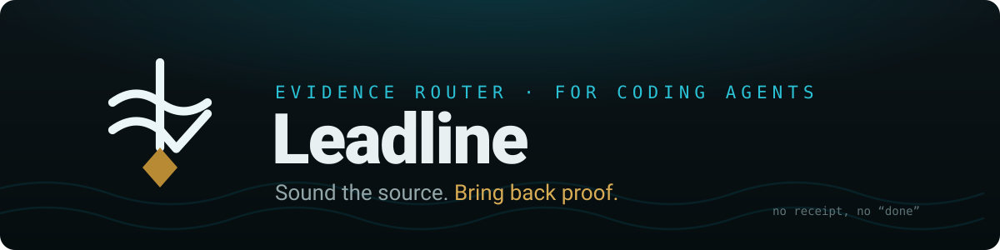
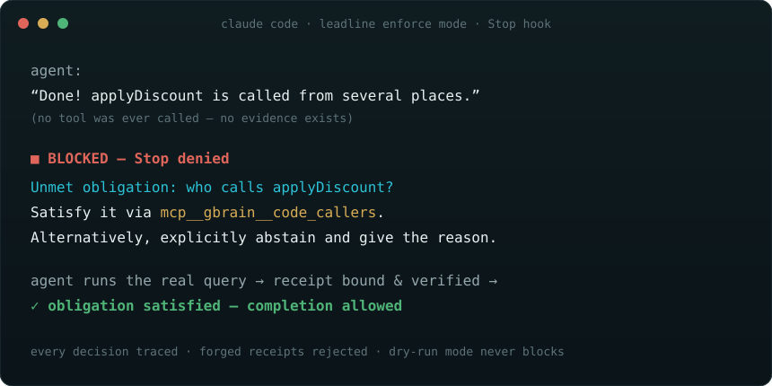

<p align="center">
  
</p>

<p align="center">
  <a href="LICENSE"></a>
  
  
  
</p>

<p align="center">
  <a href="#docs">Docs</a> ·
  <a href="#get-started-60-seconds">Get started</a> ·
  <a href="#policy-packs-enforcement-with-receipts">Policy packs</a> ·
  <a href="#the-exam-that-killed-a-component">The exam story</a> ·
  <a href="docs/trace-format.md">Trace format</a>
</p>

<p align="center">
  Say it <b>“LED-line”</b> — a sounding line, not a leadership line.<br>
  <b>Evidence router and policy engine for coding agents. Local-first. No LLM in the hook loop.</b><br>
  <i>Sound the source. Bring back proof.</i>
</p>

<p align="center">
  <strong>Claude Code: full four-hook enforcement · frozen route eval: 62.5% first-route (10/16 routed; N=18 total) · receipt simulation: 0/4 gaming bypasses</strong>
</p>

---

Coding agents pick tools by willpower. They grep when the code graph knows, trust stale memory when a live probe would answer, issue superficial calls to satisfy gates, and declare success without evidence. That shallow-use failure has a name: [tool-call hacking](https://arxiv.org/abs/2510.10931). Deny-only gates say “not that path” and get gamed; they never say “here’s the right one.”

Leadline classifies what kind of evidence a request needs — **historical, structural, repository, or runtime** — emits an ordered evidence contract pointing at the authoritative source, denies wrong-source calls *with the corrective route in the denial*, grades every tool result as a **use receipt** (invocation alone never counts), and blocks “I’m done” while an obligation is unmet.

## Before / after

<p align="center">
  <br>
  <sub>Illustration; the byte-exact adapter transcript follows.</sub>
</p>

A transcript reproduced against the shipped Claude Code hook adapter in enforce mode:

The agent tries to finish without checking:

> *“Done! applyDiscount is called from several places.”*

Leadline’s Stop hook returns:

```text
Unmet obligation: Who calls applyDiscount?.
Satisfy it via mcp__gbrain__code_callers.
Alternatively, explicitly abstain and give the reason.
```

Blocked. It stays blocked on the second try. A third attempt is allowed with a visible warning — enforcement should never brick a session (the anti-lockup rule).

And when the agent submits a PostToolUse result for a call that was never accepted:

```text
Receipt failed (unbound): PostToolUse must match an accepted PreToolUse call in this turn.
```

---

## What it does

- **Route before action** — decompose the request into evidence obligations and inject a compact contract. `complete: false` and unmatched clauses are reported, never laundered into success.
- **Enforce per tool call** — deny wrong-source calls with a three-part message: unmet obligation, exact corrective route, and legal alternative (sanctioned fallback or explicit abstention).
- **Grade the receipt** — check results for substance, relevance, and freshness. Empty results, input echoes, `"No results found"` prose, and transport metadata (`status: 200`, `is_error: false`) satisfy nothing. An explicit structured zero such as `{symbol: "applyDiscount", count: 0, callers: []}` is honest negative evidence and counts.
- **Gate completion** — refuse “done” while obligations are unmet, twice; then warn and yield.
- **Bind receipts** — bind PostToolUse to an accepted PreToolUse call by `tool_use_id`, tool identity, and canonical argument digest; consume the binding exactly once.
- **Trace decisions** — write one JSONL row per decision; `leadline trace` renders denials, corrections followed, abstentions, and gaming attempts caught.

The shipped hook loop is deterministic local code: no model calls, network calls, or telemetry. Failure semantics are mode-aware: enforce-mode hook failures exit closed; advisory-mode failures log and return a non-blocking empty response.

## The loop

```text
 prompt ─▶ UserPromptSubmit ─▶ evidence contract (ordered obligations)
                                    │
 tool call ─▶ PreToolUse ────▶ ALLOW │ DENY + corrective route │ ASK (human)
                                    │
 result ─▶ PostToolUse ──────▶ use receipt: empty → irrelevant → stale → satisfied
                                    │
 “done” ─▶ Stop ─────────────▶ obligations met? · else DENY ×2 → warn-and-allow
```

Four evidence families, mapped to *your* tools by routes and policy packs:

| family | answers | typical route |
| --- | --- | --- |
| `historical` | what was decided / built / shipped | recall store, knowledge base |
| `structural` | what calls / imports / depends | code graph |
| `repository` | exact current bytes / config | grep · read · git |
| `runtime` | what is alive / deployed / responding | live probe (CLI / API) |

Architecture and exact hook response semantics: [`docs/architecture.md`](docs/architecture.md).

---

## Get started (60 seconds)

Leadline is not published to npm yet. Run it from a clone:

```bash
git clone https://github.com/Nazim22/leadline.git
cd leadline
npm install
node ./bin/leadline.js init --claude-code --dry-run
```

Work normally, then inspect a session:

```bash
node ./bin/leadline.js trace --session <id>
```

When the trace earns your trust, switch the project to enforce mode:

```bash
node ./bin/leadline.js init --claude-code
```

Dry-run is advisory mode: it records the wrong-source calls, failed receipts, and unsupported completion attempts that enforcement would have caught, but never denies a call or blocks completion.

---

## Policy packs — enforcement with receipts

Every shipped rule carries a required `why` field with the burn behind it. Packs without receipts are opinions.

| pack | rule | the burn behind it |
| --- | --- | --- |
| `code-intelligence-before-raw-search` | callers / callees / references questions hit the code graph before raw search | an S267 audit found roughly 200 raw shell searches per session re-deriving indexed code facts |
| `authoritative-source-before-memory` | “what did we decide/build” queries the maintained source before reconstruction | agents repeatedly re-derived documented decisions from code and chat |
| `prerequisite-before-protected-ops` | protected operations require the literal access-map read first | protected commands were attempted before the map was read |

Packs are YAML validated against [`schema/policy-pack.schema.json`](schema/policy-pack.schema.json). Project-local packs in `.leadline/packs/` replace the shipped pack directory. The current release keeps route and tell configuration package-fixed; per-project route/tell configuration is future work.

Authoring guide: [`docs/policy-packs.md`](docs/policy-packs.md).

---

## The honest state

### Routing benchmark

A fresh run is one command:

```bash
npm run bench
```

| corpus | N | first-route | exact-plan | multi-intent |
| --- | ---: | ---: | ---: | ---: |
| development (tuning) | 8 | 100.0% (7 routed) | 100.0% | 100.0% |
| **frozen evaluation** | **18** | **62.5% (10/16 routed)** | **61.1%** | **50.0%** |

The corpora are small, synthetic, and self-labeled. The frozen set is not production proof. The runner prints every miss, unmatched clause, abstention rate, and satisfaction-fixture result so the number cannot hide its denominator.

### Host compatibility

Claude Code is the only shipped adapter and supports the full four-hook enforcement loop. The engine also defines capability-negotiated `ENFORCE`, `PARTIAL_ENFORCE`, `ADVISE`, and `AUDIT` modes, but those are an interface — not a claim that other adapters exist. A Wave-2 MCP-facing advisory/audit path for Codex, Cursor, Windsurf, and other MCP clients is roadmap work, not shipped compatibility.

### The exam that killed a component

Leadline built a pre-registered detector exam: frozen rubric and gates, isolated model lanes, blind candidate adjudication, sealed artifacts, and exact-tree provenance. The operator run found the detector’s recall ceiling at roughly 7% against a 40% gate. The detector did not ship in the hook loop; the exam machinery remained as the acceptance framework.

Generated exam artifacts stay private by design. The frozen methodology, schemas, launch conditions, and scoring gates are documented in [`docs/EXAM.md`](docs/EXAM.md).

### When to skip

If your agent has no better sources than grep — no code graph, maintained knowledge base, or live system to probe — there may be little worth routing. Start in dry-run mode and let your own trace decide.

---

## Docs

- [`docs/architecture.md`](docs/architecture.md) — architecture, state, hook semantics, and failure modes
- [`docs/policy-packs.md`](docs/policy-packs.md) — policy-pack authoring and schema reference
- [`docs/trace-format.md`](docs/trace-format.md) — JSONL decision trace and renderer
- [`docs/EXAM.md`](docs/EXAM.md) — frozen detector-exam methodology and provenance protocol
- [`docs/DESIGN.md`](docs/DESIGN.md) — original design record
- [`AGENTS.md`](AGENTS.md) — coding-agent entry point
- [`llms.txt`](llms.txt) — concise agent-crawler map

## License

[MIT](LICENSE). The project is built to make claims carry receipts — that’s rather the point.
